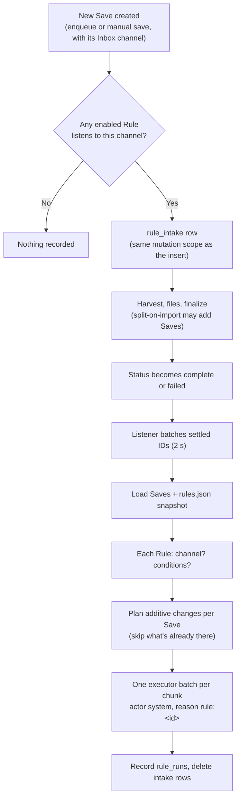

# Plan 007: Rules that file new Saves

> Executor: work phase by phase and honor each STOP condition. Issue: raphaelsalaja/pond#577. This plan is a design for review; nothing in it is built yet.
>
> Drift check: `git diff --stat cc3974ffb..HEAD -- apps/desktop/src/main/core/sync/incoming.ts apps/desktop/src/main/core/pipeline/enqueue.ts apps/desktop/src/main/core/pipeline/task-settlement.ts apps/desktop/src/main/core/pipeline/workers/finalize.ts apps/desktop/src/main/core/inbox apps/desktop/src/main/core/fish apps/desktop/src/main/core/folders.ts packages/schema/src/filters`.

## Status

- Priority: P2
- Effort: XL in total, M for the first shippable slice
- Risk: MED (it runs on every new Save, so the ingest path changes)
- Category: feature
- Planned at: `cc3974ffb`, 2026-11-27
- Status: PROPOSED, waiting for review

| Phase | Scope                                                       | Status   |
| ----- | ----------------------------------------------------------- | -------- |
| 0     | Domain term, contracts, `rules.json` store                  | TODO     |
| 1     | Engine on Save settle, Settings page, builder, single test  | TODO     |
| 2     | Library preview, Apply to Existing Saves, activity          | TODO     |
| 3     | Move Source incoming rules into Rules                       | TODO     |
| 4     | More triggers and actions, Any/All, folder-entry trigger    | DEFERRED |
| 5     | Agent operations: draft, explain, edit rules                | DEFERRED |

Phases 1 and 2 together are the first release users see. Phase 1 alone can ship behind the page if review wants it smaller.

## What already does part of this

| Piece                       | Where                                                                       | What it does today                                                                                                                                                                                                          | What Rules take from it                                                                                                                                   |
| --------------------------- | --------------------------------------------------------------------------- | --------------------------------------------------------------------------------------------------------------------------------------------------------------------------------------------------------------------------- | --------------------------------------------------------------------------------------------------------------------------------------------------------- |
| Source incoming rules       | `IncomingSaveRule` in `packages/schema/src/prefs.types.ts`, `core/sync/incoming.ts` | One folder and some tags per Account or Watch. Runs at enqueue from `enqueue.ts`, `run-list.ts`, `run-twitter.ts`, `run-threads.ts`, `watch/run.ts` and `mymind/sync.ts`. An unowned capture uses the rule only when the Source has exactly one owner. | The additive filing code (`addToFolder`, `addTagsToSaves`), the "failure is logged, sync completes" contract, and in Phase 3 the owner resolver.            |
| Folder Auto-Tags            | `folderRules` prefs slice, `core/folders.ts`, `core/folder-tags.ts`         | Tags a Save when it enters a folder or a subfolder, through `folderAssignmentTransactions`.                                                                                                                                  | Nothing to migrate. A Rule's Add to Folder goes through `assignSaveFolders`, so Auto-Tags keep firing on their own folder-entry event.                      |
| Smart Folder filters        | `Query` in `packages/schema/src/filters`, `to-sql.ts`, `match.ts`           | A validated condition tree (`QuerySchema`) over ~40 fields, compiled to SQL and also matched in memory against a `SaveLike`.                                                                                                | Rule conditions are a `Query`. No second condition language.                                                                                                |
| Smart Folder editor         | `features/library/components/smart-folders/rule-editor`, `filter-menu/summary.ts` | Field, comparator and value pickers with folder and tag choices from the Library; readable predicate text through `describePredicate`.                                                                                       | The condition card of the builder, and the readable summary.                                                                                                |
| Inbox capture paths         | `core/inbox/intake.ts`, `InboxChannel`                                       | Every real new-Save path already names a channel: `captures`, `sync`, `watches` or `imports`. Copies (crop, split, group) name none.                                                                                          | The trigger's "arrives through" choice, with the same four names users already see in Inbox settings, and the same rule for which Saves count as new.        |
| Fish Routines               | `core/fish/index.ts`, `routines.ts`                                          | Watch Save inserts on the sync action stream, wait 90 s for the batch to settle, then ask a model to propose changes for review.                                                                                             | The sync-action listener pattern and per-run history. Rules are the deterministic, no-review counterpart; they do not run through Agent chat.               |
| Library-owned JSON          | `fish.json`, `canvases/`, `conversion-presets.json`, `duplicates/dismissed.json` | Main-owned files in the Library, validated by contracts under `apps/desktop/src/shared/`, written through `library-config`.                                                                                             | Rules live in `rules.json` the same way.                                                                                                                   |

## Domain language

Proposed entry for `AGENTS.md`, under **Library**:

> **Rule**:
> A standing instruction that organizes new Saves. When a Save arrives through the capture paths a Rule listens to and matches its conditions, Pond adds it to the Rule's Folders and Tags. Rules run on their own without review, never remove anything, and don't run again because of their own changes.
> _Avoid_: automation, workflow, recipe, filter (that's a Smart Folder's conditions), routine (that's a fish's model-driven work)

Checks against the existing glossary:

- **Routine** already lists "automation" under _Avoid_, so the issue's page name "Rules & Automation" would blur the two. The page is called **Rules**.
- A Smart Folder is "a named set of filters". A Rule's matching part is called its **conditions** in copy, and the code reuses the filter `Query` type. The Smart Folder editor's internal folder `rule-editor` becomes a shared conditions editor in Phase 1 (move only, no behavior change), so "rule" in code means one thing.
- `folderRules` (Auto-Tags) and `IncomingSaveRule` are stored keys and stay as they are. In copy they remain "Auto-Tags" and "Incoming" until Phase 3.
- The trigger choices use the Inbox's capture-path names (Captures, Sync, Watches, Imports). Nothing new to learn.

## Rule model

A Rule is a trigger, conditions and actions. Main validates it with zod in `apps/desktop/src/shared/rule-contracts.ts`.

```ts
export const RuleSchema = z.object({
  id: z.string().min(1).max(64),
  name: z.string().trim().min(1).max(80),
  enabled: z.boolean(),
  trigger: RuleTriggerSchema,
  conditions: QuerySchema, // from @pond/schema/filters; empty = every Save
  actions: z.array(RuleActionSchema).min(1).max(20),
  createdAt: z.number(),
  updatedAt: z.number(),
});

/** Phase 1 has one kind. Later kinds are new variants, never a reinterpretation of this one. */
export const RuleTriggerSchema = z.discriminatedUnion("kind", [
  z.object({
    kind: z.literal("newSave"),
    /** The Inbox capture paths this Rule listens to; empty is not allowed. */
    channels: z.array(z.enum(INBOX_CHANNELS)).min(1), // export it from @pond/schema/inbox
  }),
]);

export const RuleActionSchema = z.discriminatedUnion("kind", [
  z.object({ kind: z.literal("addToFolder"), folderId: z.string().min(1) }),
  z.object({ kind: z.literal("addTags"), tags: z.array(z.string().trim().min(1)).min(1) }),
]);
```

Decisions:

- **Conditions are a filter `Query`.** Phase 1's builder only writes a flat AND group (`combinator: "and"`, predicates only), which is what the issue asks for. Storing a full `Query` means Any/All and groups in Phase 4 need no format change. Main rejects nested groups and `or` until Phase 4 turns them on, so an older build never misreads a newer file.
- **Fields a Rule may use are an allowlist**, checked in the contract. Phase 1: `source`, `account` (Accounts and Watches, since a Watch's ID is the Save's owner), `url` (contains / starts with, covers "domain is github.com"), `importedFrom`, `list`, `type`, `format` (file extension), `fileCount`, `fileSize`, `duration`, `width`, `height`, `aspect`, `title`, `creator`. Left out: fields filled later by on-device processing (`caption`, `transcript`, `color`, `sensitiveContent`) because their value depends on when processing finishes, and organization fields (`tags`, `folder`, `inbox`, `rating`, `favorite`) because on a new Save they only reflect other automation. Those come back in Phase 4 with the metadata-changed trigger.
- **Capture path is the trigger, not a condition.** It describes the event, not the Save; there is no Save column for it. Keeping it out of the `Query` keeps conditions pure functions of the Save, so the same conditions run in SQL for previews and in memory for tests.
- **Folder actions store IDs, tag actions store names**, the same as incoming rules and Auto-Tags. A deleted folder makes the action a recorded skip, not an error that stops the Rule; the list shows the Rule with a warning.
- **No ordering field.** Actions are additive unions, so the end state doesn't depend on order. Rules run in `createdAt` order only so attribution in activity is stable.

## Storage

- `rules.json` in the Library root, `{ version: 1, rules: Rule[] }`, read and written through `readBundleJson` / `writeBundleJson` like `fish.json`, with the backup copy. A missing file reads as no Rules. A Rule that fails to parse is kept in the file and shown as broken in the list rather than dropped, so a newer build's Rule survives a round trip through an older one.
- `rules.json` travels with backups and Library moves. Pond packages and transfers don't carry it, like `fish.json`.
- **Activity is index data**, not Library data. Two SQLite tables, created on open like `save_assets`:
  - `rule_intake(save_id PK, channel, owner_id, queued_at)`: Saves that arrived and haven't been evaluated yet.
  - `rule_runs(id, rule_id, save_id, at, outcome, changed_json, error)`: one row per Rule that matched a Save, plus one row per failure. Bounded to 2,000 rows per Rule, oldest first. Per-Rule counters (last run, runs, matches, last error) are aggregate queries over it.
  A rebuilt index loses history and pending intake. That's acceptable: it never re-runs a Rule, and history is diagnostic. Writing counters into `rules.json` on every Save would churn the Library file and its backups.

## When a Rule runs

The issue's trigger is "a new Save is created". For a URL Save, creation is only the enqueue: Pond knows the URL, Source, owner and capture path, but not the files, media type or title until harvest finishes. A Rule that says "video from Instagram" can't be answered at enqueue.

So a Rule evaluates **once per Save, when the Save settles**: its status leaves `ingesting` for `complete` or `failed`, or it's created already complete (local files, clipboard, Eagle, Pond packages).



Mechanics:

1. **Intake.** `newSaveInbox(channel)` and `newSaveInboxForTrigger(trigger)` are already called by every path that makes a real new Save, and never by copies. Next to them, a new `core/rules/intake.ts` records the Save in `rule_intake` with its channel and owner, but only when an enabled Rule listens to that channel. Enabling a Rule later doesn't pick up Saves already in flight, which matches "re-enabling doesn't apply retroactively".
2. **Settle.** A listener on `registerSyncActionListener` (the one Fish uses) collects Save IDs whose update sets `status` to `complete` or `failed`, and inserts whose status is already `complete`. It batches for 2 seconds, not Fish's 90, because Rules are cheap and people expect filing to feel immediate. On Library open, a sweep evaluates intake rows whose Save already settled, which covers a quit between settle and evaluation.
3. **Split-on-import.** `splitNewPost` runs inside finalize, before the original settles, and copies the original's Folders and tags to each new slide. Rule actions land on the original after that, so the slides would miss them. The engine therefore evaluates the original's slides together with it: when it settles, it also takes the live Saves of its Split Post that were created in that finalize. STOP if `split` records turn out not to identify those slides cheaply; ask before adding a column.
4. **Evaluate.** For the batch, load the Saves and match each enabled Rule in memory with `matches(rule.conditions, save)` from `@pond/schema/filters`. Every Rule sees the same snapshot, so Rules don't chain: a Rule's tag can't make another Rule match. Multiple Rules can match one Save; there is no first-match-wins.
5. **Apply.** Union every matching Rule's actions per Save, drop folders and tags the Save already has, and apply through the existing operations: `folderAssignmentTransactions` (so Auto-Tags still fire) and the tag transactions behind `addTagsToSaves`. One `executeBatch` per chunk of Saves, `actor: "system"`, `actorReason: "rule:<ruleId>"`, no Undo step: like incoming rules, it's part of the capture, and a global Undo entry for every arriving Save would bury the user's own steps. The Fish listener only reacts to inserts and to Saves entering review, so a Rule's changes never wake a Routine. Rules don't listen to tag or folder changes, so they can't loop.
6. **Isolate.** Evaluation runs per Rule in a `try`. A Rule whose conditions throw (a bad stored value) records an error row and the other Rules continue. A failed executor batch records an error against every Rule in it, retries per Save once, and never touches the Save's ingest status. Nothing here can fail a capture, Sync or import.
7. **Record.** For each matched Rule and Save, store what actually changed (folders and tags added) or "already organized". Then delete the intake row. Intake deletion runs after the batch commits; a crash between the two re-evaluates, and the additive diff makes the second pass a no-op.

Why not evaluate at enqueue for Rules that only use URL, Source and owner? It would file links a few seconds sooner, but `source` is the site identity, which harvest can change through `siteName`, and two evaluation moments make "why didn't this match" much harder to explain. Phase 4 can revisit it with measurements.

### Relation to Fish Routines

|                  | Rule                               | Routine                                 |
| ---------------- | ---------------------------------- | --------------------------------------- |
| Decides with     | Stored conditions                  | A model reading the Saves               |
| Changes          | Applied at once, additive only     | Proposed, waits for review              |
| Runs             | Every matching Save, at settle     | Batches after 90 s, at most 200 Saves   |
| Needs a provider | No                                 | Yes                                     |
| Lives in         | `rules.json`, Settings → Rules     | `fish.json`, the fish page              |

They stay separate stores and separate engines. Rules don't call the Agent. Routines see Saves after Rules have filed them, because Rules settle within seconds and Routines wait 90. A Routine can propose a Rule in Phase 5.

## Relation to Source incoming rules and Auto-Tags

- **Phase 1–2:** both keep working exactly as now. Incoming rules run at enqueue, Rules at settle; the additive diff means a Rule that repeats an incoming rule changes nothing the second time. The Rules page lists incoming rules read-only in a "From Sources" section with a link to each Account or Watch, so the page already shows everything that files new Saves.
- **Phase 3:** each `IncomingSaveRule` becomes a Rule with trigger channels `sync` + `watches` + `captures` and a special condition "Belongs to <Account/Watch>". That condition can't be a plain `account` predicate, because today an unowned capture counts for the Source's only Account or only Watch. It's a Rule-only field that calls the same resolver as `incomingRuleFor`. Migration runs once per Library on open: write the Rules, then clear `sync.incoming` in the same step, with a marker in `rules.json` so it never runs twice. Sources → Organize becomes a list of that owner's Rules with "New Rule for this Account". The enqueue-time calls to `fileIncomingSaves` are removed in the same change. STOP if any caller relies on filing before harvest (for example a Sync that reads the folder right after enqueue).
- **Auto-Tags stay where they are.** They fire on a different event (entering a folder), and the issue is clear they must not turn into a new-Save trigger. Phase 4 adds a "Save added to a folder" trigger; only then can Auto-Tags move into Rules, and only if review wants that. The Rules page shows each folder's Auto-Tags read-only with a link to the folder.

## Testing a Rule

- **Single Save (Phase 1).** Pick a Save; main returns, without writing: whether the trigger applies (its intake channel when known, otherwise "can't tell for an older Save" and the conditions are still checked), each predicate with pass or fail (evaluate each as a one-predicate `Query` with `matches`), and the changes that would happen after the already-there diff, including Auto-Tags the folder would add.
- **Library preview (Phase 2).** Compile the conditions to SQL with the existing filter compiler, scoped to live Saves. Return the match count, per-action counts ("would add to Research: 40, already there: 2"), and the first 60 matches for a grid. Trigger channels are ignored here, and the page says so: an existing Save has no capture path on record.
- **Apply to Existing Saves (Phase 2).** Only from the preview, behind a confirm that repeats the counts. Runs as a cancellable job in chunks of 200 through the same apply step, reports progress, and records one Undo step for the whole job (it's a user action). Interrupted jobs stop between chunks; what was applied stays, and running it again only does the rest because the diff skips finished Saves.

## Interface

`/settings/rules`, label **Rules**, group Library, after Library. A child page `/settings/rules/$ruleId` holds the builder, the way Sources has child pages. The Settings window is its own renderer, so the folder and tag pickers and the Save picker read through typed queries that the Settings preload already allows or gains (`folders.list`, tag list, a title search). STOP and ask if the conditions editor can't load in the Settings renderer without pulling the Library feature's stores; the fallback is a full Library page at `/rules` beside `/canvases`.

**List.** One row per Rule: switch, name, a one-line summary, last run ("Filed 3 Saves · 2 h ago", "Never run", or an error mark), and a menu with Edit, Duplicate, Test, Activity (Phase 2) and Delete. Search by name, a segmented All / On / Off filter, sort by name, last edited, last run. Empty state explains a Rule in one sentence with a New Rule button and three starter examples from the issue (PDFs to a folder, a site to a folder, a Source's videos to a folder) that open the builder prefilled. Below: "From Sources" and "Auto-Tags" read-only sections.

**Builder.** A vertical stack of connected cards, as the issue asks, using `Settings.Card`:

1. **When** — "A new Save arrives through" with four checkboxes (Captures, Sync, Watches, Imports), all on by default.
2. **If** — "Every condition matches", then the shared conditions editor restricted to the Rule field allowlist. No conditions means every new Save, which the summary says plainly.
3. **Then** — action rows: Add to Folder (folder picker) and Add Tags (tag picker, multiple). Add Action menu.
4. **Review** — the live summary sentence, Test on a Save, and in Phase 2 Preview in Library.

Save writes the Rule and leaves it on; nothing is applied to existing Saves. Cards that appear (a new condition, a new action, the test result) animate their height in with the shared motion tokens, per the design principles. The summary sentence morphs rather than swaps.

Summary text is built in `shared/rule-summary.ts` from the filter `describePredicate` wording: "When a new Save arrives through Captures or Imports, if its format is PDF, add it to Research and tag it Reading."

## Agent and API exposure

- Phase 1–2 register `rules.list`, `rules.get`, `rules.test` and `rules.preview` as read operations in the IPC catalog, so the loopback API and MCP can read them. `rules.save`, `rules.setEnabled`, `rules.delete` and `rules.applyToExisting` are mutations, so they are review-gated for the Agent and need a preview token over the API. That is the existing catalog behavior; Phase 5 only adds prompts and a builder entry point.
- Phase 5: "Build with Pond" in the builder sends the sentence to the active fish with the Rule contract and field allowlist as tools. The model returns a `Rule` draft that main validates, the builder opens it filled in, and saving stays a user action. Explanations ("why wasn't this filed?") read `rule_runs` and `rules.test`. No model runs while Saves arrive.

## Build order

### Phase 0 — groundwork

- Add the **Rule** glossary entry to `AGENTS.md` and a Rules paragraph to `ARCHITECTURE.md`.
- `shared/rule-contracts.ts`: schemas, field allowlist, Phase 1 shape check (flat AND only).
- `core/rules/store.ts`: read, write, CRUD, duplicate, broken-Rule passthrough. Tests with a temp Library.
- Move `smart-folders/rule-editor` to a shared conditions editor that takes an allowed-field list. Move only; existing Smart Folder tests pass unchanged.

STOP if the move needs behavior changes in the Smart Folder editor.

### Phase 1 — first shippable slice

- `rule_intake` and `rule_runs` tables and their creation on open.
- `core/rules/intake.ts` hooked beside `newSaveInbox` / `newSaveInboxForTrigger`.
- `core/rules/engine.ts`: pure `planRuleChanges(rules, saves, intake) → { perSave, perRule }`, plus the apply step through folder and tag transactions. Started from `main/index.ts` beside `startFishRoutines`, stopped and restarted by `library-services` on Library switch.
- Settle listener, open-time sweep, split-on-import handling.
- IPC: `rules.list`, `rules.save`, `rules.setEnabled`, `rules.duplicate`, `rules.delete`, `rules.test`, each with a contract and a handler test.
- Settings page, builder, single-Save test, last-run line from `rule_runs`.
- Tests (temp Library, no module mocks): matching, non-matching, channel filter, two Rules on one Save, disabled Rule, idempotent second run, deleted folder skip, one Rule throwing while another applies, capture still completing when apply fails, split slides receiving actions, Library switch mid-batch.

Done: a person creates a Rule in Settings, saves a PDF or a GitHub link through any capture path, and finds it in the right folder with the right tags once it finishes downloading; the Rule's row says it ran.

### Phase 2 — preview, apply, activity

- `rules.preview`, `rules.applyToExisting` (cancellable job with progress, one Undo step), `rules.activity`.
- Activity drawer per Rule: time, Save, what changed, skips and errors.
- A `rule:<id>` attention Notification when a Rule fails five times in a row, resolved when it next succeeds, through `core/notifications`.

### Phase 3 — Source incoming rules

As described above, with an idempotent migration test on open and on Library switch, and fixtures for Account-owned, Watch-owned and unowned-single-owner captures.

### Phase 4 — deferred

Any/All and groups (the stored format already allows them), organization fields as conditions, triggers for "added to a folder" and "metadata changed" with explicit loop guards, actions for Favorite, Rating and Inbox state. Driven by requests, not by the list.

### Phase 5 — deferred

Agent drafting, editing and explanation through the catalog operations above.

## Open questions for review

1. **Where the page lives.** Settings → Library → Rules, as the issue asks, or a full Library page beside Canvases? Settings keeps it with the other Library settings; a Library page makes the Save picker and preview grid cheaper to build. The plan assumes Settings.
2. **Run at settle only.** Filing waits for harvest, typically seconds, sometimes longer behind a rate limit. Is that acceptable for links, or should URL-only Rules also run at enqueue?
3. **Failed Saves.** The plan runs Rules on a Save whose ingest failed, using what's known (URL, Source, owner). The alternative is to wait for a successful retry.
4. **Name.** "Rules" for the page and the object, dropping "Automation" because Routines already own that idea.
